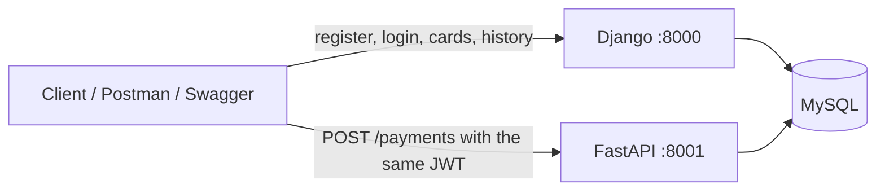
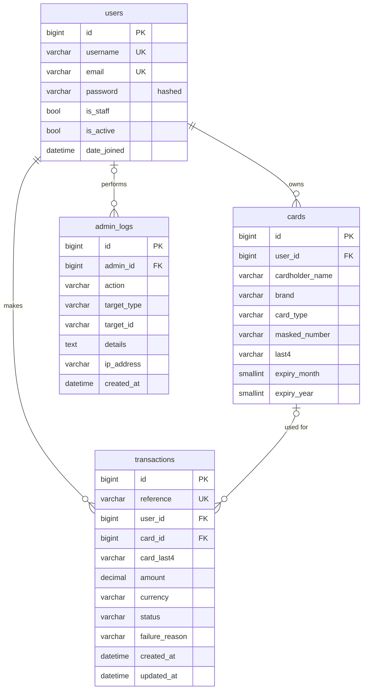

# Credit Card Payment System

This is my submission for the Full Stack Junior Application Task. It is a small payment system where users sign
up, save a card, pay with it and look back at their transaction history, and an admin can see what is going on.
The backend is split in two: **Django** handles accounts, cards, history and the admin side, and **FastAPI** handles
the payment itself. Both talk to one **MySQL** database, which I managed through MySQL Workbench.

## How I structured it

I wanted the two frameworks to have clearly separate jobs instead of overlapping, so I split things like this:

| Service | What it does | Port |
|---------|--------------|------|
| Django (`django_app/`) | Registration, login (JWT), logout, saved cards, transaction history and filters, admin panel, CSV export, daily summary | 8000 |
| FastAPI (`fastapi_app/`) | Takes a payment, marks it PENDING, simulates the bank, then marks it SUCCESS or FAILED | 8001 |
| MySQL | One shared database, `credit_card_payments` | 3306 |



The part I spent the most time thinking about was how the two services trust each other. Django issues the JWT when
you log in. FastAPI never calls Django: it checks the token itself using the same secret key (`JWT_SECRET_KEY` in
`.env`). It also looks the user up in the database, so a deactivated user's token stops working there too.

Django owns the database schema through its migrations. FastAPI maps just the columns it needs with SQLAlchemy,
so there is one source of truth for the tables.

## Running it

You need Python 3.12 or 3.13, MySQL Server 8, MySQL Workbench and Git. I would avoid very new Python versions,
because Django 5.0 and some packages lag behind them.

**1. Create the database (MySQL Workbench).** Connect as `root`, open `database/01_create_database.sql` with
File -> Open SQL Script, and run it with the lightning-bolt button. It creates the `credit_card_payments` database
and a user called `ccp_user`.

**2. Set up Python.** From the project root:

```bat
python -m venv .venv
.venv\Scripts\activate
pip install -r requirements.txt
copy .env.example .env
```

On macOS or Linux, use `source .venv/bin/activate` and `cp .env.example .env`. If you picked a different database
user or password in Workbench, change `DB_USER` and `DB_PASSWORD` in `.env`.

**3. Create the tables and an admin account, then start Django.**

```bat
cd django_app
python manage.py migrate
python manage.py createsuperuser
python manage.py runserver 8000
```

Refresh the schema in Workbench and you will see `users`, `cards`, `transactions` and `admin_logs`, plus the
tables Django adds for itself.

**4. Start the payment service** in a second terminal, with the same virtual environment active:

```bat
cd fastapi_app
python -m uvicorn app.main:app --reload --port 8001
```

### A quick walkthrough with curl

```bash
# register and log in
curl -X POST localhost:8000/api/auth/register/ -H "Content-Type: application/json" \
  -d '{"username":"alice","email":"alice@example.com","password":"StrongPass#12345","password_confirm":"StrongPass#12345"}'
curl -X POST localhost:8000/api/auth/login/ -H "Content-Type: application/json" \
  -d '{"username":"alice","password":"StrongPass#12345"}'
TOKEN=<paste the access token>

# save a card
curl -X POST localhost:8000/api/cards/ -H "Authorization: Bearer $TOKEN" -H "Content-Type: application/json" \
  -d '{"cardholder_name":"Alice Doe","card_type":"CREDIT","card_number":"4111 1111 1111 1111","cvv":"123","expiry_month":12,"expiry_year":2032}'

# pay with it, then look at the history
curl -X POST localhost:8001/payments -H "Authorization: Bearer $TOKEN" -H "Content-Type: application/json" \
  -d '{"card_id":1,"amount":"49.99","currency":"USD","description":"Order #1001"}'
curl "localhost:8000/api/transactions/?status=SUCCESS&min_amount=10" -H "Authorization: Bearer $TOKEN"
```

### Test cards

Only use test numbers here, never a real card. They all pass the card checksum:

| Number | Notes |
|--------|-------|
| `4111 1111 1111 1111` | Visa |
| `5555 5555 5555 4444` | Mastercard |
| `3782 822463 10005` | Amex (needs a 4-digit CVV) |
| `6011 1111 1111 1117` | Discover |
| `4000 0000 0000 0002` | Always declined |
| `4000 0000 0000 9995` | Always "insufficient funds" |

The payment is simulated. A card ending in `0002` or `9995` always fails as shown. Otherwise the result is random,
with a success rate of 80% that you can change with `PAYMENT_SUCCESS_RATE` in `.env`.

## What is in it

**Authentication.** Registration, login with JWT, logout, and protected routes. Passwords go through Django's
PBKDF2 hashing and its password validators. Logout puts the refresh token on a blacklist. Every route needs a
logged-in user by default, and the few public ones (register and login) opt out explicitly.

**Card management.** Users can add, list, view and delete cards. The number is checked for length and the Luhn
checksum, the expiry date must be in the future, and the CVV format is checked. Only the masked number
(`**** **** **** 1234`) and the last four digits are saved. A user can never see or delete someone else's card;
asking for it just returns "not found".

**Payments (FastAPI).** `POST /payments` takes a saved card id and an amount, never card details. It saves the
transaction as PENDING, runs the simulated bank, then updates it to SUCCESS or FAILED. If the simulation itself
crashes, the payment is marked FAILED, so nothing stays stuck in PENDING.

**Transactions.** Users see their own history and can filter by date range, amount range and status, and sort by
date or amount. Admins can export transactions to CSV.

**Admin panel.** I used Django's admin site. Admins can manage users, look at cards and transactions (read-only,
so history can't be edited), see a daily payment summary, and export CSV. Admin actions such as creating or
deactivating a user and exporting data are recorded in the `admin_logs` table.

## API documentation

| What | Where |
|------|-------|
| Django Swagger | http://127.0.0.1:8000/api/docs/ |
| Django ReDoc | http://127.0.0.1:8000/api/redoc/ |
| FastAPI Swagger | http://127.0.0.1:8001/docs |
| FastAPI ReDoc | http://127.0.0.1:8001/redoc |
| Admin panel | http://127.0.0.1:8000/admin/ |
| Postman collection | `postman/credit_card_payment_system.postman_collection.json` |

In either Swagger page, log in through Django first, click **Authorize** and paste the `access` token. For Postman,
import the collection and run its folders in order, because each request saves the tokens and ids the next one needs.

### Django endpoints (port 8000)

| Method | Path | Who | Purpose |
|--------|------|-----|---------|
| POST | `/api/auth/register/` | anyone | Create an account |
| POST | `/api/auth/login/` | anyone | Get access and refresh tokens |
| POST | `/api/auth/token/refresh/` | anyone | Get a new access token |
| POST | `/api/auth/logout/` | user | Blacklist the refresh token |
| GET | `/api/auth/me/` | user | Current user profile |
| GET, POST | `/api/cards/` | user | List or add a card |
| GET, DELETE | `/api/cards/{id}/` | user | View or delete a card |
| GET | `/api/transactions/` | user | History with filters |
| GET | `/api/transactions/{id}/` | user | One transaction |
| GET | `/api/admin/users/`, `/api/admin/cards/`, `/api/admin/transactions/`, `/api/admin/logs/` | admin | Read-only lists |
| PATCH | `/api/admin/users/{id}/` | admin | Activate or deactivate a user |
| GET | `/api/admin/summary/daily/` | admin | Daily payment summary |
| GET | `/api/admin/transactions/export/` | admin | CSV export |

### FastAPI endpoints (port 8001)

| Method | Path | Who | Purpose |
|--------|------|-----|---------|
| POST | `/payments` | user | Make a payment |
| GET | `/payments/{reference}` | user | Check a payment's status |
| GET | `/health` | anyone | Health check |

## Database schema



The full SQL is in `database/02_schema_reference.sql`. It is there for reading only, because the tables are created
by `python manage.py migrate`. `database/03_useful_queries.sql` has queries I used in Workbench to check the data.

A few choices worth explaining:

- There is no column for the full card number or the CVV, so they cannot leak from the database.
- A transaction keeps `card_last4` as a copy. If the user deletes the card, `card_id` becomes empty but the history
  still shows which card was used.
- A user who has transactions cannot be deleted (`ON DELETE RESTRICT`), because financial records should not
  disappear. Deactivating the user is the way to go.

## Security

- **No CVV storage.** If a CVV is sent when adding a card, it is format-checked and thrown away. The payment
  endpoint rejects any unexpected field, so card data can't be sent to it at all.
- **No full card numbers.** Only the masked number and last four digits are stored.
- **Encrypted passwords.** Salted PBKDF2-SHA256 hashes, never plain text.
- **JWT authentication.** Access tokens last 15 minutes and refresh tokens one day. FastAPI checks the signature,
  expiry and token type, and that the user is still active.
- **Input validation.** Django serializers and Pydantic models check every input and return a 400 or 422 for bad data.
- **SQL injection.** All queries go through the Django ORM or SQLAlchemy with bound parameters. There is no SQL
  built from strings, and the tests send injection attempts.
- **Smaller things.** Login and register are rate-limited, CSV cells starting with `=`, `+`, `-` or `@` are escaped
  so Excel can't run them as formulas, an admin can't deactivate their own account, and the API can't be used to
  make someone an admin.

### Limitations

- A logged-out user's access token still works until it expires (15 minutes), because only the refresh token is
  blacklisted.
- The payments are simulated. A real system would never receive the card number on its own server. It would use a
  provider like Stripe, which gives back a token. This project does see the number briefly when a card is added.
- This setup is for development. Before deploying it would need `DJANGO_DEBUG=False`, real secret keys, HTTPS and a
  restricted `ALLOWED_HOSTS`.

## Tests

The tests run on an in-memory SQLite database, so you do not need MySQL for them.

```bat
cd django_app
pytest

cd ..\fastapi_app
pytest
```

Each run fails if coverage drops below 50%. They cover registration, login, logout and protected routes, password
hashing, card validation and the check that no number or CVV is stored, ownership rules, the payment status
lifecycle, bad or expired tokens, invalid input, injection attempts, filters, the CSV export and the admin pages.

## Git

I used Conventional Commit messages (`feat(cards): ...`, `test: ...`, `docs: ...`) and committed in the order
I built things: database, Django setup, authentication, cards, transactions, admin, payments, tests and docs.

## Screenshots

| | |
|---|---|
|  |  |
|  |  |
|  |  |
|  |  |

## Project layout

```
credit-card-payment-system/
├── README.md  requirements.txt  .env.example
├── database/        SQL scripts for MySQL Workbench
├── django_app/
│   ├── config/      settings and urls
│   ├── accounts/    user model, register, login, logout
│   ├── cards/       card model, validation, API
│   ├── transactions/  model, filters, CSV export, history API
│   └── adminpanel/  audit log, admin site, daily summary
├── fastapi_app/
│   ├── app/         payment service
│   └── tests/
├── postman/         Postman collection
└── docs/screenshots/
```
